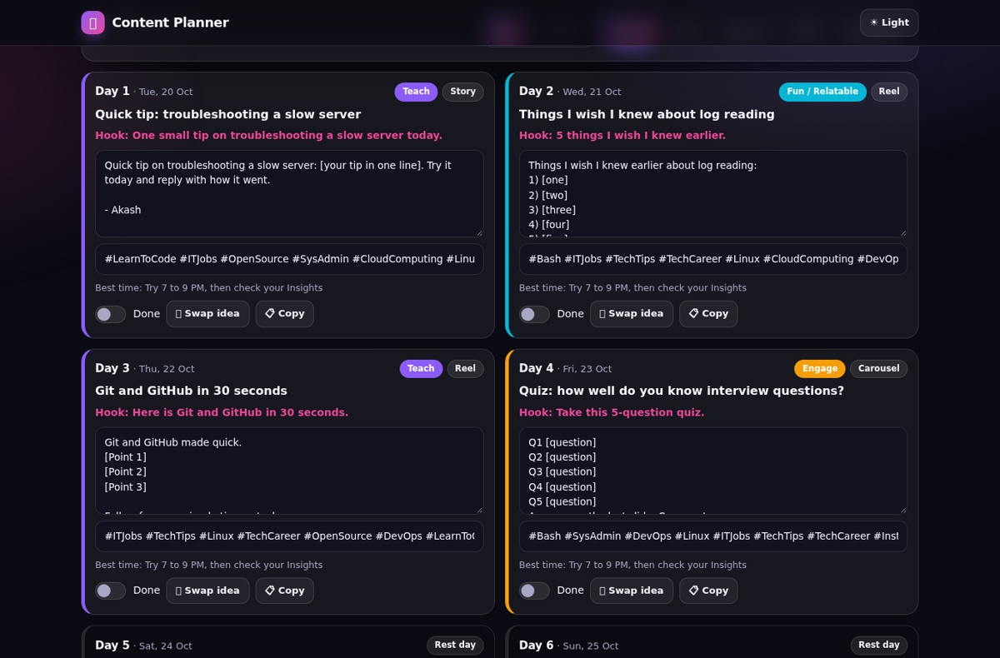
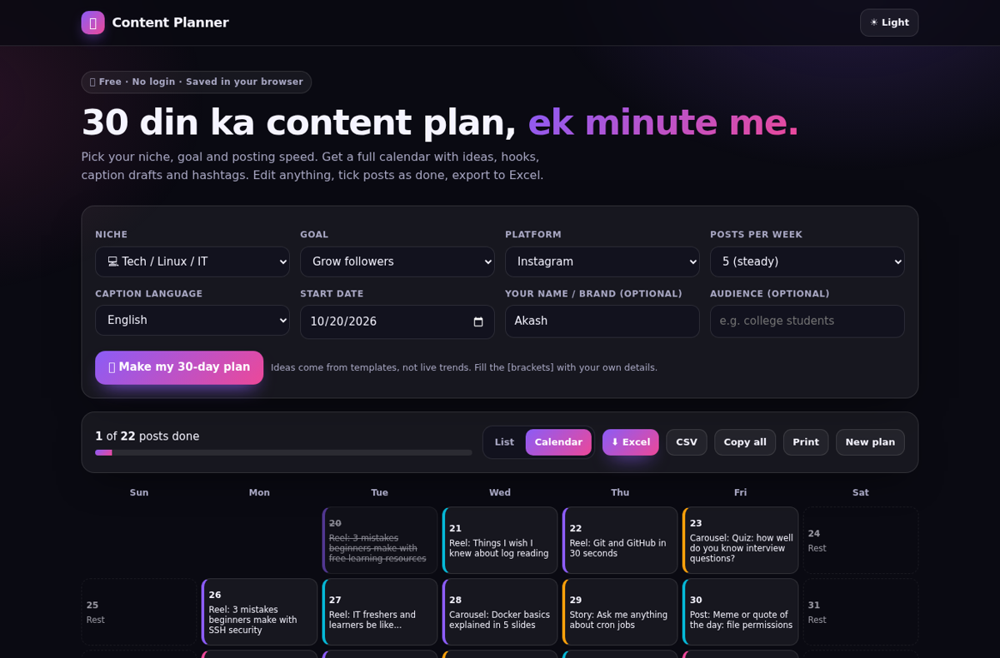
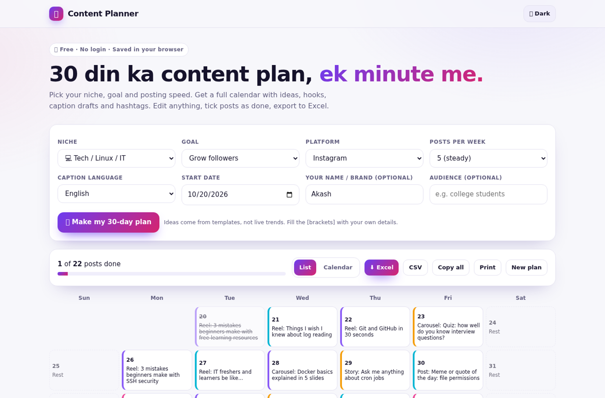
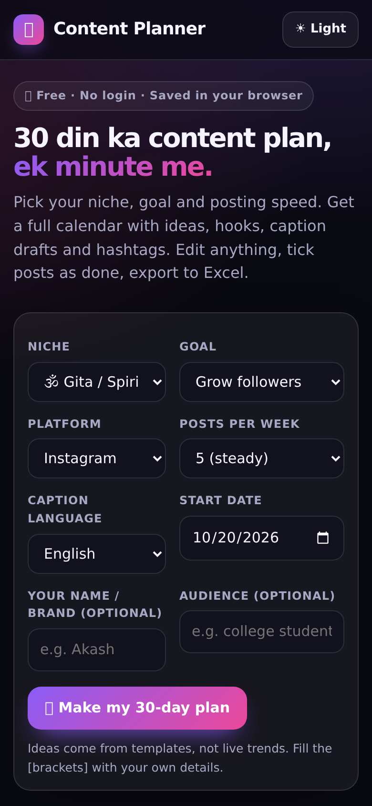

# 30-Day Content Planner

Get a 30-day posting calendar with ideas, hooks, caption drafts and hashtags for your niche. Edit it, tick posts as done, export to Excel. Free, no login.

## Screenshots






## Features

- 11 niches (Gita, motivation, tech/Linux, local business, fitness, food, travel, study, DJ/events, beauty, creator)
- 3 goals (grow followers, get customers, build trust) that change the mix of post types
- English or Hinglish caption drafts, posts per week 3, 5 or 7
- Hook, caption draft, hashtags and best-time hint on every post day
- Swap any idea, edit captions, mark done with progress bar
- List view and calendar view
- Export to Excel (.xlsx), CSV, copy all, print
- Plan is saved in your browser

## How to use

1. Pick niche, goal, platform and posting speed.
2. Tap Make my 30-day plan.
3. Fill the [brackets] with your own details, swap ideas you do not like, export when ready.

## Honest limits

- Template-based ideas, not live trends. It does not read your analytics.
- Best-time hints are generic starting points, check your own Insights.
- Use only real photos, numbers and customer feedback (with permission).

## Tech and privacy

Plain HTML, CSS and JavaScript. Excel export uses SheetJS mini build (vendor/xlsx.mini.min.js, Apache-2.0), loaded only when you export. Everything runs in your browser. Nothing you type is uploaded. Installable as a PWA and works offline after the first visit.

## Run locally

```bash
git clone <this repo>
cd <folder>
python3 -m http.server 8000
# open http://localhost:8000
```

## Deploy free

GitHub Pages: Settings, Pages, Deploy from branch `main`, folder `/ (root)`.

## Author

Built by Akash Vishwakarma.
